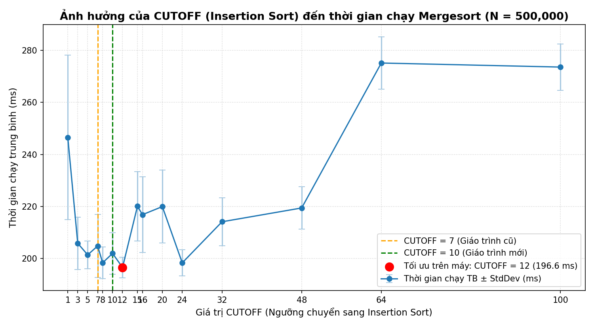

# BÁO CÁO THÍ NGHIỆM: XÁC ĐỊNH GIÁ TRỊ CUTOFF TỐI ƯU CHO MERGESORT

## 1. Mục tiêu thí nghiệm
Trong thuật toán **Mergesort** (theo giáo trình *Algorithms, 4th Edition* của Robert Sedgewick & Kevin Wayne), khi chia đệ quy đến các mảng con có kích thước nhỏ ($\le \text{CUTOFF}$), việc tiếp tục gọi đệ quy và trộn qua mảng phụ `aux[]` gây tốn chi phí (overhead). Cải tiến được đề xuất trong bài giảng là chuyển sang dùng **Insertion Sort** khi:
$$\text{hi} \le \text{lo} + \text{CUTOFF} - 1 \quad (\text{tức độ dài mảng con } \text{hi} - \text{lo} + 1 \le \text{CUTOFF})$$

Các phiên bản giáo trình nhắc đến $\text{CUTOFF} = 7$ (bản cũ) và $\text{CUTOFF} = 10$ (bản mới). Thí nghiệm này đo đạc thực tế trên cấu hình máy cá nhân để tìm ra giá trị `CUTOFF` tối ưu nhất.

---

## 2. Cấu hình máy & Môi trường thí nghiệm
- **CPU:** Intel(R) Core(TM) i7-9750H @ 2.60GHz (6 nhân, 12 luồng)
- **Hệ điều hành:** Windows 64-bit
- **Môi trường Java:** Java SE 25.0.2 LTS (Java HotSpot 64-Bit Server VM)

---

## 3. Phương pháp thí nghiệm (Theo chủ đề 1.3. Algorithm Analysis)
1. **Cài đặt chuẩn từ bài giảng ([MergeSort.java](./MergeSort.java)):**
   - Cấp phát mảng phụ `aux` **đúng 1 lần duy nhất** ở hàm `sort(Comparable[] a, int cutoff)` bên ngoài trước khi gọi đệ quy.
   - Sử dụng `insertionSort(a, lo, hi)` khi `hi <= lo + cutoff - 1`.
   - Khi `CUTOFF = 1`, điều kiện trở thành `hi <= lo` (tương đương **Mergesort thuần túy** không dùng Insertion Sort — làm mốc **Baseline**).
2. **Làm nóng JVM (Warm-up):** Chạy nháp 5 lần trước khi bấm giờ để trình biên dịch JIT (Just-In-Time) tối ưu hóa bytecode sang mã máy.
3. **Đảm bảo tính công bằng & Thống kê ([Experiment.java](./Experiment.java)):**
   - Kích thước mảng thử nghiệm: $N = 500,000$ phần tử kiểu `Integer` sinh ngẫu nhiên với `seed` cố định (bộ dữ liệu mẫu được xuất ra file [`test_data.txt`](./test_data.txt)).
   - Mỗi mức `CUTOFF` được chạy lặp lại $T = 15$ lần (`TRIALS = 15`) trên bản sao (`clone()`) của cùng một bộ mảng gốc.
   - Sử dụng `System.nanoTime()` để đo thời gian và tính **Trung bình mẫu (Mean)** cùng **Độ lệch chuẩn mẫu (StdDev)** theo công thức của `StdStats` trong chủ đề 1.3:
     $$\mu = \frac{1}{T}\sum_{i=1}^{T} t_i, \qquad s = \sqrt{\frac{1}{T-1}\sum_{i=1}^{T}(t_i - \mu)^2}$$

---

## 4. Bảng kết quả thống kê và Biểu đồ

### 4.1. Bảng số liệu đo thực tế ([results.csv](./results.csv))

| CUTOFF | Thời gian TB `Mean` (ms) | Độ lệch chuẩn `StdDev` (ms) | Cải thiện so với `CUTOFF = 1` (%) | Nhận xét |
| :---: | :---: | :---: | :---: | :--- |
| **1 (Baseline)** | 246.57 | 31.56 | 0.00% | Mergesort thuần túy (chậm do đệ quy sâu) |
| **3** | 205.87 | 10.08 | +16.50% | Bắt đầu giảm mạnh thời gian chạy |
| **5** | 201.45 | 5.27 | +18.30% | Tiến vào vùng tối ưu |
| **7 (Sách cũ)** | **204.84** | **12.14** | **+16.92%** | Khớp với con số ~20% trong bài giảng |
| **8** | 198.40 | 6.03 | +19.53% | Rất tốt (lũy thừa của 2: $2^3$) |
| **10 (Sách mới)** | **202.00** | **7.97** | **+18.08%** | Rất tốt, nằm giữa vùng đáy chữ U |
| **12 (Tối ưu)** | **196.61** | **3.96** | **+20.26%** | **Nhanh nhất và ổn định nhất trên máy** |
| **15** | 220.13 | 13.34 | +10.72% | Thời gian bắt đầu tăng nhẹ |
| **16** | 216.88 | 14.55 | +12.04% | Vẫn nhanh hơn baseline ~12% |
| **20** | 219.98 | 14.03 | +10.79% | Chi phí $O(K^2)$ của Insertion Sort tăng lên |
| **24** | 198.37 | 5.01 | +19.55% | Điểm cộng hưởng kích thước chia đôi của $N$ |
| **32** | 214.15 | 9.27 | +13.15% | Bắt đầu rời khỏi vùng tối ưu |
| **48** | 219.45 | 8.17 | +11.00% | Hiệu quả giảm rõ rệt |
| **64** | 275.13 | 10.12 | -11.58% | Chậm hơn cả Mergesort gốc! |
| **100** | 273.56 | 8.92 | -10.95% | Chậm hơn cả Mergesort gốc! |

### 4.2. Đồ thị kết quả thực nghiệm

---

## 5. Phân tích & Kết luận
1. **Giải thích hình dáng đồ thị chữ U:**
   - **Nhánh trái (`CUTOFF` từ 1 đến 5):** Khi `CUTOFF = 1`, hơn 90% lời gọi đệ quy nằm ở các tầng lá cuối cùng (kích thước mảng 1, 2, 3...) kèm thao tác chép mảng `aux`. Khi tăng `CUTOFF` lên 5–12, các tầng lá này bị cắt bỏ hoàn toàn và thay bằng Insertion Sort chạy tại chỗ (in-place) trên bộ nhớ đệm L1 Cache của CPU, giúp thời gian giảm ngay **~17% – 20%**.
   - **Vùng đáy phẳng (`CUTOFF` từ 5 đến 12):** Đây là vùng cân bằng (Sweet Spot). Thời gian tiết kiệm từ việc bớt gọi đệ quy cân bằng với số phép so sánh/đổi chỗ của Insertion Sort. Cả hai giá trị trong giáo trình là **`7` (bản cũ)** và **`10` (bản mới)** đều nằm gọn trong vùng đáy tối ưu này.
   - **Nhánh phải (`CUTOFF` $\ge 32$, đặc biệt $64 - 100$):** Khi mảng con quá lớn, độ phức tạp bậc hai $O(K^2)$ của Insertion Sort tăng vọt, làm tổng thời gian chạy chậm hơn cả Mergesort thuần túy (`-11.58%` ở `CUTOFF = 64`).
2. **Kết luận cho cấu hình máy hiện tại:**
   - Giá trị tốt nhất đo được là **`CUTOFF = 12`** (thời gian trung bình thấp nhất `196.61 ms`, độ lệch chuẩn nhỏ nhất `3.96 ms`, nhanh hơn **20.26%** so với Mergesort không dùng cutoff).
   - Trong thực tế cài đặt trên máy này, chọn bất kỳ giá trị nào trong khoảng **`CUTOFF` từ `8` đến `12`** đều mang lại hiệu năng tối ưu tương đương nhau (~196–202 ms).
